<div align="center">

<picture><source media="(prefers-color-scheme: dark)" srcset="assets/hero-dark.svg"></picture>

<picture><source media="(prefers-color-scheme: dark)" srcset="assets/social-l-dark.svg"></picture><a href="https://t.me/MoltenGram"><picture><source media="(prefers-color-scheme: dark)" srcset="assets/social-1-dark.svg"></picture></a><a href="https://github.com/MoltenSt4r/MoltenGram"><picture><source media="(prefers-color-scheme: dark)" srcset="assets/social-2-dark.svg"></picture></a><picture><source media="(prefers-color-scheme: dark)" srcset="assets/social-r-dark.svg"></picture>

<picture><source media="(prefers-color-scheme: dark)" srcset="assets/about-dark.svg"></picture>

<picture><source media="(prefers-color-scheme: dark)" srcset="assets/wave-dark.svg"></picture>

</div>

---

## О проекте

**MoltenGram** — это мощная и кастомизируемая модификация Telegram для Android, основанная на [exteraless](https://github.com/exteraless/exteraless) (наследнике [exteraGram](https://github.com/exteraSquad/exteraGram) и [NagramX](https://github.com/risin42/NagramX)).

Проект сочетает эстетику чистого **Material 3 / Material You**, плавные интерфейсные решения и продвинутый функционал для медиа, музыки и плагинов.

* **Имя пакета:** `com.moltengram.app` (устанавливается параллельно с официальным Telegram и exteraless).

---

## Скачать и подключить

* **Прямая загрузка APK (v12.10.6):** [MoltenGram-v12.10.6-ae8723f.1261.apk](https://github.com/MoltenSt4r/MoltenGram/releases/download/v12.10.6/MoltenGram-v12.10.6-ae8723f.1261.apk)
* **Официальный сайт:** [moltenstar.space](https://moltenstar.space)
* **Репозиторий F-Droid:** `https://moltenst4r.github.io/MoltenGram/fdroid/repo`
  * Подключить в F-Droid / Neo Store / Droid-ify: `fdroidrepos://moltenst4r.github.io/MoltenGram/fdroid/repo?fingerprint=4B4EFFEE9D4CCBCB75DC3BF2E2A21655F2F35747B2D95FCF836E186FCE9D5030`
* **Канал с обновлениями в Telegram:** [@MoltenGram](https://t.me/MoltenGram)

---

## Что нового в v12.10.6

- 🔥 **Карусель медиа (Media Carousel):** горизонтальная прокрутка карточек медиа в чатах и каналах.
- 📐 **Исправление границ и подписи:** устранен выход текста подписи за пределы пузыря сообщения, точный учет `captionOffsetX` и ширины.
- 📰 **Широкие посты в каналах:** карусели корректно поддерживают полноразмерный режим постов каналов.
- 💬 **Позиционирование:** исправлено размещение текста над каруселью (`captionAbove`) и плашки времени в чатах.
- 🔄 **Плавный скролл:** сброс позиции карусели на начало альбома и корректный реверсивный порядок.
- 🎨 **Калибровка иконок лаунчера:** Классическая (выпуск за пределы без рамок), переработанная Star, Ледник, Google, Точки и др.
- 🧩 **Стабильность:** исправления каталога Plugin Store и движка PythonPluginsEngine.
- 🚀 **База Telegram:** обновление базы до официальной версии 12.10.6.

---

## Ключевые особенности

### 🎨 Material 3 и оформление
- **Карусель медиа (Media Carousel):** отображение альбомов с фото и видео в виде плавной горизонтальной карусели карточек вместо привычной сетки.
- **Формы аватарок:** раздельная настройка геометрических форм аватаров для пользователей, групп и каналов (Squircle, Rounded, скругления).
- **Папки-чипсы:** настраиваемая панель папок чатов со стилями (Filled, Outlined, Ghost), плавным морфингом скруглений и анимациями перехода.
- **Анимации ввода:** плавный курсор, эффекты появления текста и частицы при удалении символов.
- **Набор иконок:** коллекция уникальных стилей лаунчера (MoltenGram, Dotted, Neon, Lava, Cyber, Cosmic, Mocha, Glacier, Lavender, Beer, Magma, Holo) и адаптивные монохромные иконки под Nothing OS и Google Pixel.

### 🎵 Медиаплеер и видео
- **Material 3 Video Seekbar:** удобный и красивый ползунок перемотки видео в чатах.
- **Плеер в стиле MetroList:** эргономичный модальный экран воспроизведения музыки.
- **Синхронизированные тексты песен (Lyrics):** загрузка текста из нескольких провайдеров с drag-and-drop сортировкой приоритетов и возможностью перевода.
- **Управление воспроизведением:** слайдер скорости и непрерывный фоновый звук.

### 🧩 Плагины и кастомизация
- **Встроенный Plugin Store:** каталог дополнений прямо в приложении — установка и обновление в один клик.
- **Движок Python-плагинов:** поддержка плагинов экосистемы exteraless с безопасной моделью изоляции и разрешений.
- **Импорт и экспорт:** прямая поддержка скриптов `.py`, автоконвертация в `.plugin`, резервное копирование всех плагинов и настроек.

### ⚡ Удобство и производительность
- **Интеграция с Shizuku:** бесшовное фоновое обновление клиента без всплывающих окон подтверждения.
- **Fastest Proxy:** автоматический тест пинга и подключение к самому быстрому прокси-серверу.
- **AI-инструменты:** саммаризация сообщений в чатах и быстрое распознавание голосовых заметок (Groq Whisper, Requesty).
- **Безопасность:** вход по ключам доступа Passkey (Google Password Manager, Bitwarden, KeePassDX и др.).

---

### Ссылки

* Канал в Telegram: [@MoltenGram](https://t.me/MoltenGram)
* Исходный код: [github.com/MoltenSt4r/MoltenGram](https://github.com/MoltenSt4r/MoltenGram)
* Апстрим (exteraless): [github.com/exteraless/exteraless](https://github.com/exteraless/exteraless)
* Канал апстрима: [@exteraless](https://t.me/exteraless)

---

### Сборка

1. Клонировать репозиторий с подмодулями:

   ```bash
   git clone --recursive --shallow-submodules git@github.com:MoltenSt4r/MoltenGram.git
   cd MoltenGram
   ```

2. Получить `TELEGRAM_APP_ID` и `TELEGRAM_APP_HASH` на [my.telegram.org](https://my.telegram.org/auth) и создать `local.properties` в корне проекта:

   ```properties
   TELEGRAM_APP_ID=<ваш_app_id>
   TELEGRAM_APP_HASH=<ваш_app_hash>
   ```

3. Для подписи APK положить свой `TMessagesProj/release.keystore` и указать параметры в `local.properties`:

   ```properties
   KEYSTORE_PASS=<пароль_хранилища>
   ALIAS_NAME=<имя_ключа>
   ALIAS_PASS=<пароль_ключа>
   ```

   *(Без собственного ключа сборка подпишется стандартным отладочным debug-ключом Android).*

4. Для push-уведомлений положить `TMessagesProj/google-services.json` (пакет `com.moltengram.app`).

5. Собрать через Gradle:

   ```bash
   ./gradlew :TMessagesProj:assembleDebug
   ```

> **Примечание по архитектурам (ABI):** Chaquopy собирает Python 3.12 только под 64-битные `arm64-v8a` и `x86_64`. Переменная окружения `NATIVE_TARGET` задает целевой ABI: `arm64-v8a` (быстрая сборка под телефон), `universal` (оба) или `SKIP` (без нативной части).

---

### Благодарности

- Авторы и разработчики [exteraless](https://github.com/exteraless/exteraless)
- [exteraGram](https://github.com/exteraSquad/exteraGram) & [BlueprintDsgn](https://t.me/BlueprintDsgn)
- [AyuGram](https://github.com/AyuGram/AyuGram4A)
- [Cherrygram](https://github.com/arsLan4k1390/Cherrygram)
- [Nagram](https://github.com/NextAlone/Nagram) / [NagramX](https://github.com/risin42/NagramX)
- [Nekogram](https://github.com/Nekogram/Nekogram)
- [OctoGram](https://github.com/OctoGramApp/OctoGram)

---

## English

### About

**MoltenGram** is a feature-packed, modern Telegram client for Android based on [exteraless](https://github.com/exteraless/exteraless) (the successor to [exteraGram](https://github.com/exteraSquad/exteraGram) and [NagramX](https://github.com/risin42/NagramX)).

It brings a refined **Material 3 / Material You** experience, an interactive media carousel, a powerful music player, a built-in plugin store, and intelligent performance enhancements.

* **Package name:** `com.moltengram.app` (installs alongside official Telegram and exteraless).

### Download & Repository
* **Direct APK Download (v12.10.6):** [MoltenGram-v12.10.6-ae8723f.1261.apk](https://github.com/MoltenSt4r/MoltenGram/releases/download/v12.10.6/MoltenGram-v12.10.6-ae8723f.1261.apk)
* **Official Website:** [moltenstar.space](https://moltenstar.space)
* **F-Droid Repository:** `https://moltenst4r.github.io/MoltenGram/fdroid/repo`
  * Add to F-Droid client: `fdroidrepos://moltenst4r.github.io/MoltenGram/fdroid/repo?fingerprint=4B4EFFEE9D4CCBCB75DC3BF2E2A21655F2F35747B2D95FCF836E186FCE9D5030`
* **Release Channel:** [@MoltenGram](https://t.me/MoltenGram)

### What's New in v12.10.6
- 🔥 **Media Carousel:** Horizontal smooth card carousel in chats and channels.
- 📐 **Bubble bounds & caption overflow fix:** Fixed caption text protruding outside message bubbles with exact measurement.
- 📰 **Wide channel posts:** Full-width support for media carousels in channels.
- 💬 **Layout fixes:** Proper placement for `captionAbove` headers and time badge in chats.
- 🔄 **Carousel reset:** Auto-scroll to album start and correct reverse ordering.
- 🎨 **Launcher icons calibrated:** Classic full bleed, updated Star, Glacier, Google, Dotted, etc.
- 🧩 **Plugin Store & engine:** Enhanced catalog stability and Python plugins compatibility.
- 🚀 **Telegram base:** Updated to upstream version 12.10.6.

### Key Features
- **Media Carousel:** View grouped photos and videos in a smooth horizontal card carousel instead of the classic grid.
- **Material 3 UI:** Customizable avatar shapes per chat type, chip folders with fluid morphing and animations, and MD3 switches.
- **Music & Video Player:** Material 3 video seekbar, MetroList-inspired player, multi-source synced lyrics with drag-and-drop priority.
- **Built-in Plugin Store:** 1-click install and update for Python plugins, direct `.py` import, full backup and restore.
- **Shizuku Integration:** Seamless background app updates without manual package installer prompts.
- **Smart Tools:** Fastest proxy auto-connect, text input animations, Passkey support, and AI chat utilities.

### Building
```bash
git clone --recursive --shallow-submodules git@github.com:MoltenSt4r/MoltenGram.git
cd MoltenGram
./gradlew :TMessagesProj:assembleDebug
```
