<div align="center">

<picture><source media="(prefers-color-scheme: dark)" srcset="assets/hero-dark-v2.svg"></picture>

<picture><source media="(prefers-color-scheme: dark)" srcset="assets/social-l-dark-v2.svg"></picture><a href="https://t.me/MoltenGram"><picture><source media="(prefers-color-scheme: dark)" srcset="assets/social-1-dark-v2.svg"></picture></a><a href="https://github.com/MoltenSt4r/MoltenGram"><picture><source media="(prefers-color-scheme: dark)" srcset="assets/social-2-dark-v2.svg"></picture></a><picture><source media="(prefers-color-scheme: dark)" srcset="assets/social-r-dark-v2.svg"></picture>

<picture><source media="(prefers-color-scheme: dark)" srcset="assets/about-dark-v2.svg"></picture>

<picture><source media="(prefers-color-scheme: dark)" srcset="assets/wave-dark-v2.svg"></picture>

</div>

---

## О проекте

**MoltenGram** — это мощная и кастомизируемая модификация Telegram для Android, основанная на [exteraless](https://github.com/exteraless/exteraless) (наследнике [exteraGram](https://github.com/exteraSquad/exteraGram) и [NagramX](https://github.com/risin42/NagramX)).

Проект сочетает эстетику чистого **Material 3 / Material You**, плавные интерфейсные решения и продвинутый функционал для медиа, музыки и плагинов.

* **Имя пакета:** `com.moltengram.app` (устанавливается параллельно с официальным Telegram и exteraless).

---

## Скачать и подключить

* **Прямая загрузка APK (v12.10.6):** [MoltenGram-v12.10.6-ae8723f.1261.apk](https://github.com/MoltenSt4r/MoltenGram/releases/download/v12.10.6/MoltenGram-v12.10.6-ae8723f.1261.apk)
* **Официальный сайт:** [moltenstar.space](https://moltenstar.space)
* **Репозиторий F-Droid:** `https://moltenst4r.github.io/MoltenGram/fdroid/repo`
  * Подключить в F-Droid / Neo Store / Droid-ify: `fdroidrepos://moltenst4r.github.io/MoltenGram/fdroid/repo?fingerprint=4B4EFFEE9D4CCBCB75DC3BF2E2A21655F2F35747B2D95FCF836E186FCE9D5030`
* **Канал с обновлениями в Telegram:** [@MoltenGram](https://t.me/MoltenGram)

---

## Схема наименования релизов

В проекте принята строгая концепция именования каналов обновлений:
* **Release (Стабильные):** Десерты (текущий релиз — **Tiramisu**). Минорные фиксы не меняют название десерта, а функциональные обновления MoltenGram переходят к следующему десерту независимо от версии Telegram.
* **Beta (Бета):** Ингредиенты и специи релизного десерта (для Tiramisu: *Mascarpone*, *Espresso*, *Cocoa*, *Savoiardi*, *Marsala*).
* **Canary (Канарейки):** Химические элементы и соединения (*Titanium*, *Xenon*, *Cobalt*, *Neon*, *Graphene*, *Helium*, *Argon*).

---

## Что нового в v12.10.6 — Tiramisu

- **Формы аватарок Material 3:** 15 параметрических экспрессивных форм аватаров с раздельной настройкой для пользователей, групп, каналов и избранного.
- **Карусель альбомов:** отображение сгруппированных фото и видео в виде горизонтальной карусели Material 3 с точной подгонкой границ сообщений.
- **Nothing Glyph Interface:** полная интеграция подсветки задней панели для 13 моделей Nothing Phone и CMF Phone.
- **Динамический Monet:** нативная системная палитра Material You с корректными ролями Neutral 1 / Neutral 2.
- **Адаптивные иконки:** монохромные векторы под Nothing OS и Google Pixel для всех фирменных вариантов иконки.
- **Плавающее поле ввода:** стиль ввода Material 3 и деликатные анимации отправки и получения сообщений.
- **Мультимедиа:** локальные плейлисты аудио с экспортом M3U8/.mplaylist, карусель альбомов и ползунок перемотки видео в стиле Material 3.
- **База Telegram:** обновление официальной базы до версии 12.10.6.

---

## Ключевые особенности

### 🎨 Material 3 и интерфейс
- **Карусель медиа (Media Carousel):** отображение альбомов с фото и видео в виде плавной горизонтальной карусели карточек вместо жесткой сетки.
- **Формы аватарок:** раздельная настройка геометрических форм аватаров для пользователей, групп и каналов (Squircle, Rounded, Cookie, Clover и др.).
- **Папки-чипсы:** настраиваемая панель папок чатов со стилями (Filled, Outlined, Ghost), плавным морфингом скруглений и анимациями перехода.
- **Анимации ввода:** плавный курсор, эффекты появления текста и частицы при удалении символов.
- **Коллекция иконок:** фирменные стили оформления лаунчера с адаптивными монохромными слоями под Nothing OS и Google Pixel.

### 🎵 Медиа и плеер
- **Material 3 Video Seekbar:** удобный ползунок перемотки видео в чатах.
- **Локальные плейлисты:** создание и управление пользовательскими списками воспроизведения музыки с поддержкой M3U8 и .mplaylist.
- **Синхронизированные тексты песен:** отображение текстов треков с поддержкой нескольких провайдеров.
- **Управление воспроизведением:** слайдер скорости и непрерывный фоновый звук.

### ⚡ Система и интеграции
- **Nothing Glyph:** аппаратное управление светодиодными лентами и матрицей на Nothing Phone (1, 2, 2a, 3, 4) при событиях вызовов, сообщений и записи.
- **Интеграция с Shizuku:** бесшовное фоновое обновление клиента без диалогов системного инсталлятора.
- **Кастомный эмодзи-статус:** установка анимированных статусов без подписки Telegram Premium через невидимый био-код.
- **Быстрый прокси:** автоматический тест задержки и подключение к самому быстрому серверу.

---

### Ссылки

* Канал в Telegram: [@MoltenGram](https://t.me/MoltenGram)
* Исходный код: [github.com/MoltenSt4r/MoltenGram](https://github.com/MoltenSt4r/MoltenGram)
* Апстрим (exteraless): [github.com/exteraless/exteraless](https://github.com/exteraless/exteraless)
* Канал апстрима: [@exteraless](https://t.me/exteraless)

---

### Сборка

1. Клонировать репозиторий с подмодулями:

   ```bash
   git clone --recursive --shallow-submodules git@github.com:MoltenSt4r/MoltenGram.git
   cd MoltenGram
   ```

2. Получить `TELEGRAM_APP_ID` и `TELEGRAM_APP_HASH` на [my.telegram.org](https://my.telegram.org/auth) и создать `local.properties` в корне проекта:

   ```properties
   TELEGRAM_APP_ID=<ваш_app_id>
   TELEGRAM_APP_HASH=<ваш_app_hash>
   ```

3. Для подписи APK положить свой `TMessagesProj/release.keystore` и указать параметры в `local.properties`:

   ```properties
   KEYSTORE_PASS=<пароль_хранилища>
   ALIAS_NAME=<имя_ключа>
   ALIAS_PASS=<пароль_ключа>
   ```

   *(Без собственного ключа сборка подпишется стандартным отладочным debug-ключом Android).*

4. Для push-уведомлений положить `TMessagesProj/google-services.json` (пакет `com.moltengram.app`).

5. Собрать через Gradle:

   ```bash
   ./gradlew :TMessagesProj:assembleDebug
   ```

> **Примечание по архитектурам (ABI):** Chaquopy собирает Python 3.12 только под 64-битные `arm64-v8a` и `x86_64`. Переменная окружения `NATIVE_TARGET` задает целевой ABI: `arm64-v8a` (быстрая сборка под телефон), `universal` (оба) или `SKIP` (без нативной части).

---

### Благодарности

- Авторы и разработчики [exteraless](https://github.com/exteraless/exteraless)
- [exteraGram](https://github.com/exteraSquad/exteraGram) & [BlueprintDsgn](https://t.me/BlueprintDsgn)
- [AyuGram](https://github.com/AyuGram/AyuGram4A)
- [Cherrygram](https://github.com/arsLan4k1390/Cherrygram)
- [Nagram](https://github.com/NextAlone/Nagram) / [NagramX](https://github.com/risin42/NagramX)
- [Nekogram](https://github.com/Nekogram/Nekogram)
- [OctoGram](https://github.com/OctoGramApp/OctoGram)

---

## English

### About

**MoltenGram** is a feature-packed, modern Telegram client for Android based on [exteraless](https://github.com/exteraless/exteraless) (the successor to [exteraGram](https://github.com/exteraSquad/exteraGram) and [NagramX](https://github.com/risin42/NagramX)).

It brings a refined **Material 3 / Material You** experience, an interactive media carousel, a powerful music player, a built-in plugin store, and intelligent performance enhancements.

* **Package name:** `com.moltengram.app` (installs alongside official Telegram and exteraless).

### Download & Repository
* **Direct APK Download (v12.10.6):** [MoltenGram-v12.10.6-ae8723f.1261.apk](https://github.com/MoltenSt4r/MoltenGram/releases/download/v12.10.6/MoltenGram-v12.10.6-ae8723f.1261.apk)
* **Official Website:** [moltenstar.space](https://moltenstar.space)
* **F-Droid Repository:** `https://moltenst4r.github.io/MoltenGram/fdroid/repo`
  * Add to F-Droid client: `fdroidrepos://moltenst4r.github.io/MoltenGram/fdroid/repo?fingerprint=4B4EFFEE9D4CCBCB75DC3BF2E2A21655F2F35747B2D95FCF836E186FCE9D5030`
* **Release Channel:** [@MoltenGram](https://t.me/MoltenGram)

### Release Naming Scheme

The project follows a structured naming convention:
* **Release (Stable):** Desserts (current release: **Tiramisu**). Minor patch updates retain the dessert codename; significant feature updates advance to the next dessert regardless of Telegram upstream version changes.
* **Beta:** Ingredients or spices associated with the release dessert (for Tiramisu: *Mascarpone*, *Espresso*, *Cocoa*, *Savoiardi*, *Marsala*).
* **Canary:** Chemical elements and compounds (*Titanium*, *Xenon*, *Cobalt*, *Neon*, *Graphene*, *Helium*, *Argon*).

### What's New in v12.10.6 — Tiramisu
- **Material 3 Avatar Shapes:** 15 custom parametric shapes with independent configuration for users, groups, channels, and saved messages.
- **Media Carousel:** Smooth horizontal card carousel for grouped photos and videos with exact bubble boundary padding.
- **Nothing Glyph Interface:** Full hardware integration for 13 Nothing Phone and CMF Phone models.
- **Dynamic Monet:** Native Material You dynamic theming with proper Neutral 1 / Neutral 2 palette roles.
- **Monochrome Icons:** System adaptive monochrome vectors under Nothing OS and Google Pixel.
- **Floating Input & Animations:** Material 3 chat input bar with restrained physics message animations.
- **MetroList Player & Synced Lyrics:** Modernized audio playback interface with multi-source synchronized lyrics.
- **Telegram Base:** Updated upstream Telegram engine to version 12.10.6.

### Key Features
- **Media Carousel:** View grouped photos and videos in a smooth horizontal card carousel instead of the classic grid.
- **Material 3 UI:** Customizable avatar shapes per chat type, chip folders with fluid morphing and animations, and MD3 switches.
- **Music & Video Player:** Material 3 video seekbar, MetroList-inspired player, multi-source synced lyrics with drag-and-drop priority.
- **Built-in Plugin Store:** 1-click install and update for Python plugins, direct `.py` import, full backup and restore.
- **Shizuku Integration:** Seamless background app updates without manual package installer prompts.
- **Smart Tools:** Fastest proxy auto-connect, text input animations, Passkey support, and AI chat utilities.

### Building
```bash
git clone --recursive --shallow-submodules git@github.com:MoltenSt4r/MoltenGram.git
cd MoltenGram
./gradlew :TMessagesProj:assembleDebug
```
